# Mobile website review

Reviewed in Chrome device emulation at 393 × 852 (iPhone 16) and 375 × 667 (iPhone SE). Default Earth & Forest theme. This is a visual and limited interaction review, not a full accessibility or real-device performance test. No site code was changed.

## Findings

- High: Sticky navigation covers section titles after anchor navigation. Education, Research, Projects, Publications, and Toolkit show this in the captures. Add a mobile scroll offset matching the header height, then verify every anchor.
- Medium: Education remains in two columns at phone width. Degree names, dates, and descriptions wrap into narrow strips. Use one column on phones.
- Medium: Navigation shows only the first few links; the rest require horizontal scrolling. There is no clear instruction or menu control for reaching Projects, Publications, Toolkit, and Contact. Use a compact accessible menu or a stronger scroll affordance. The header also consumes about 175 CSS pixels of vertical space.
- Low: Muted body text and small navigation/disclosure labels may be hard to read or tap. Measure contrast and target sizes before making accessibility claims.
- Low: Four publication statistic cards stack into a long block before the actual papers. A compact two-column mobile summary could shorten the path to publications.

## Steps and screenshot evidence

1. Hero and navigation — portrait, affiliation and CTA layout fit. Navigation discoverability needs attention.

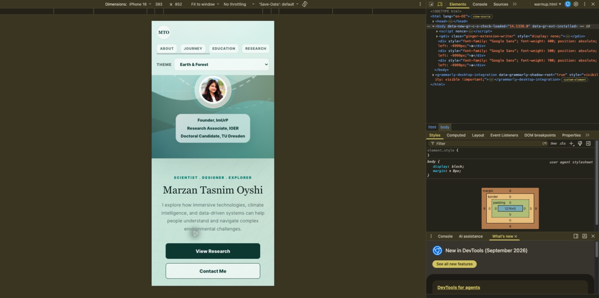

2. About — text and secondary card fit in one column. Sticky header covers content as the page scrolls.

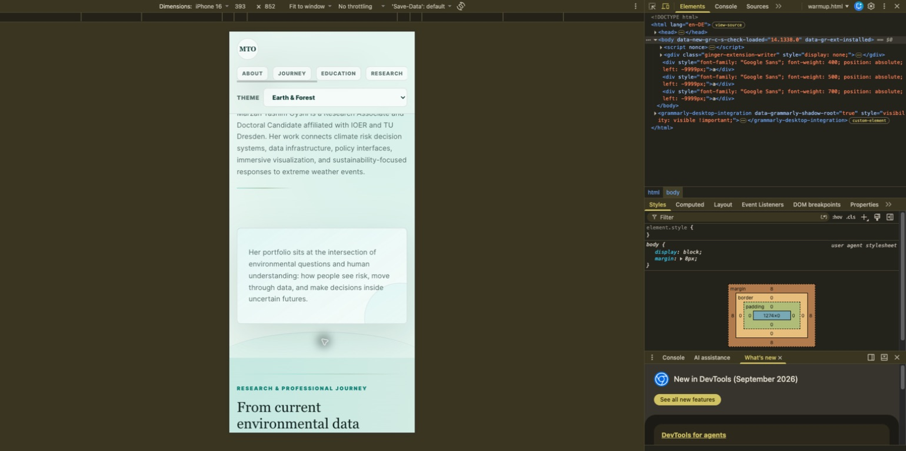

3. Professional journey — summary and career cards fit in one column.

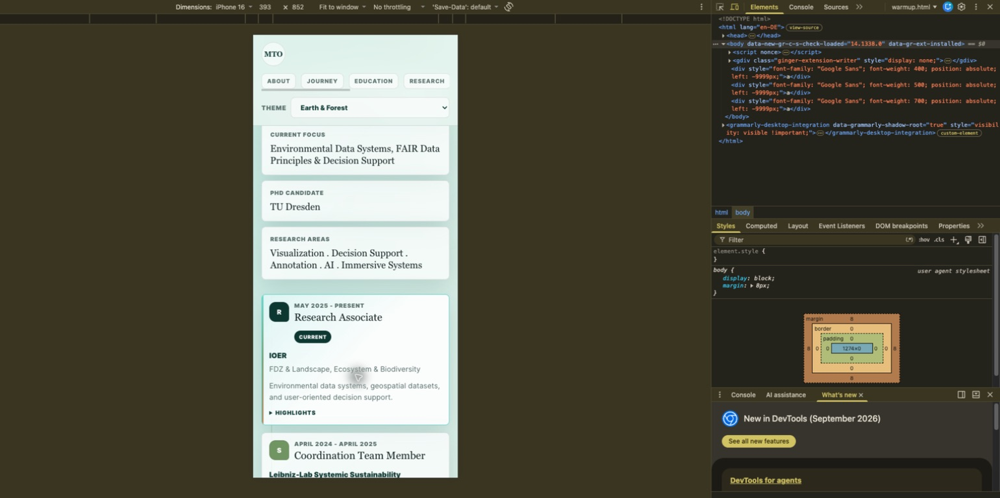

4. Education — needs improvement: two narrow columns and obscured heading at anchor landing.

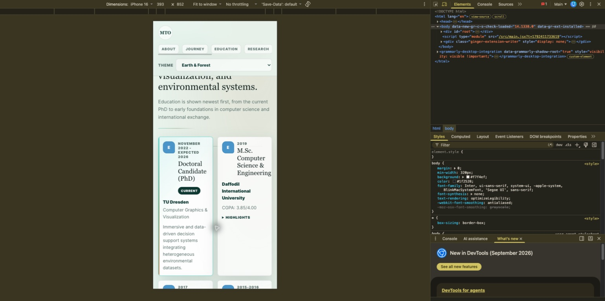

5. Research interests — pills fit the viewport; heading is obscured at anchor landing.

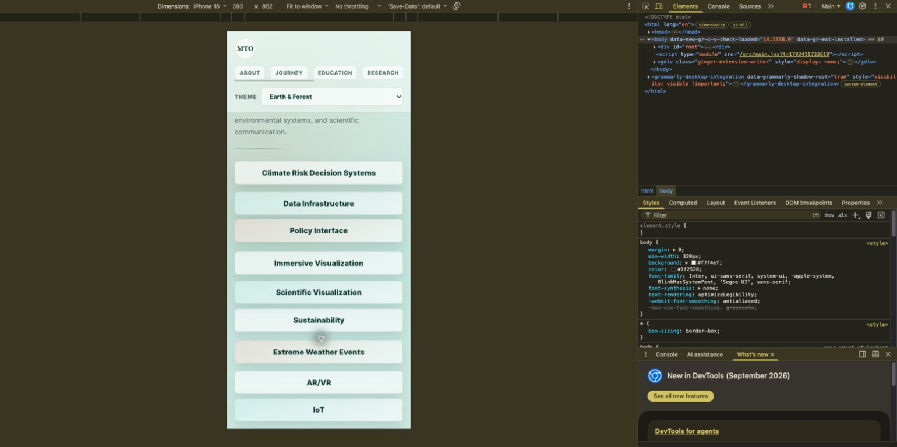

6. Projects — cards, descriptions and tags fit; small disclosure/link targets merit measurement. Heading is obscured at anchor landing.

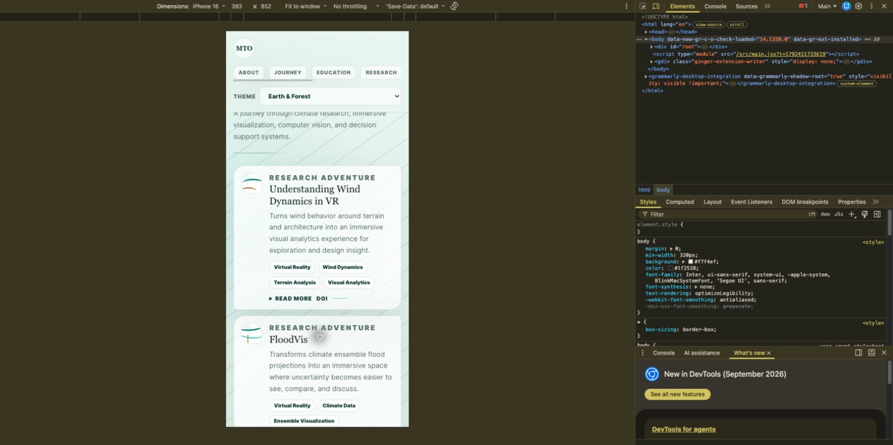

7. Publications — cards reflow well and long titles wrap. Summary consumes substantial space. Abstract button was activated successfully.

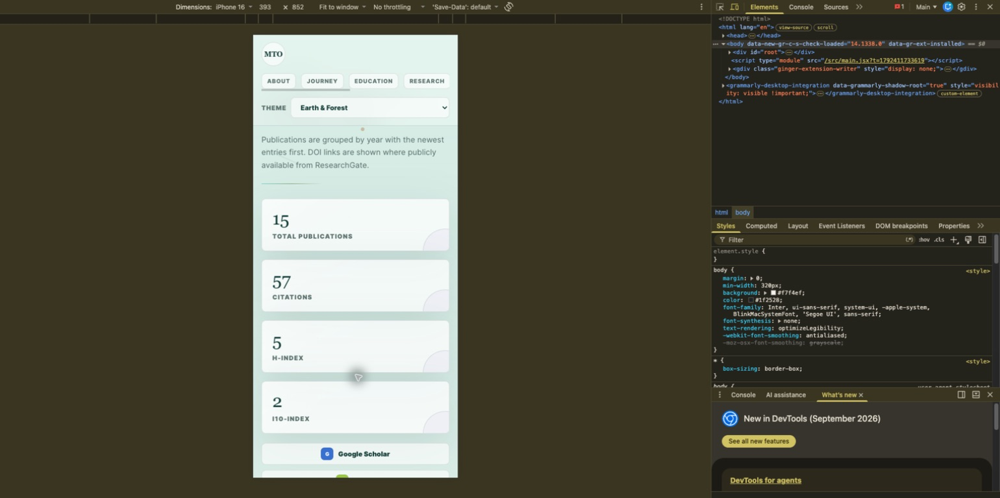

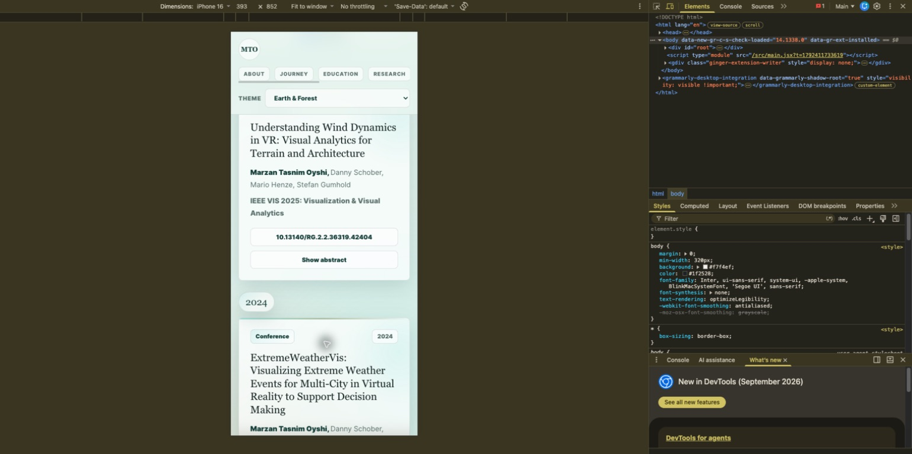

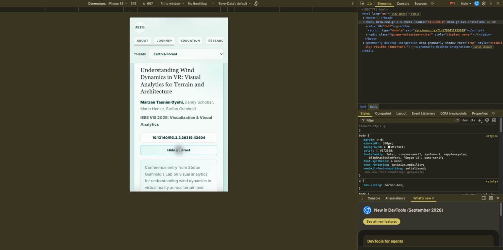

8. Toolkit — cards and tags fit. Accordion button was activated and collapsed successfully. Heading is obscured at anchor landing.

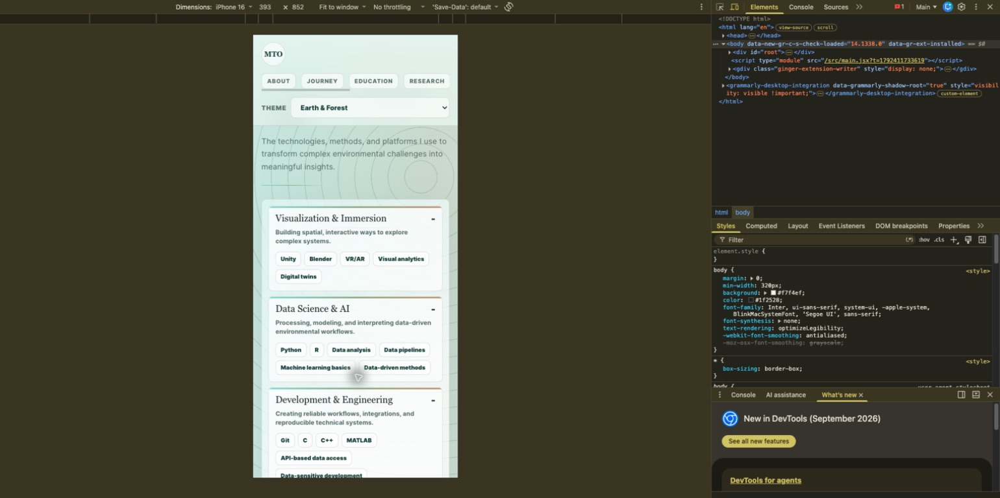

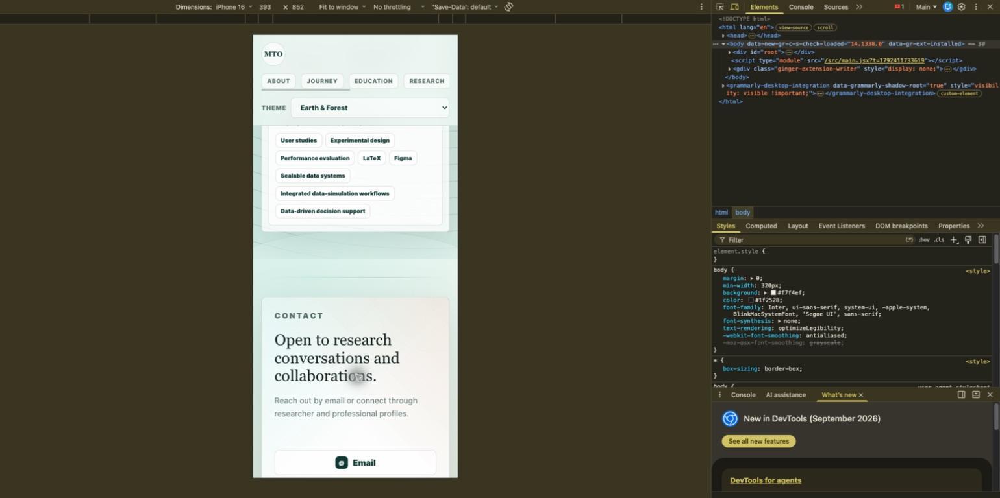

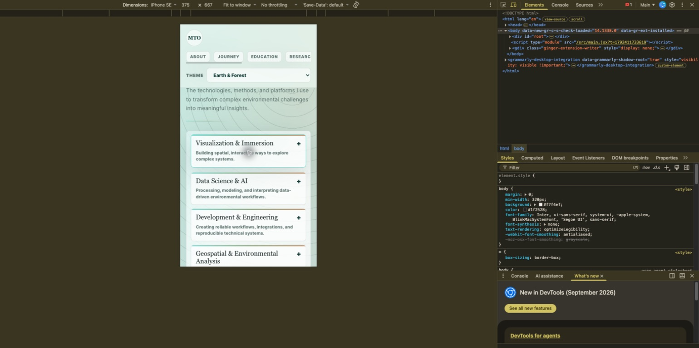

9. Contact — all four contact/profile buttons fit in one column. External destinations and mail client were not opened.

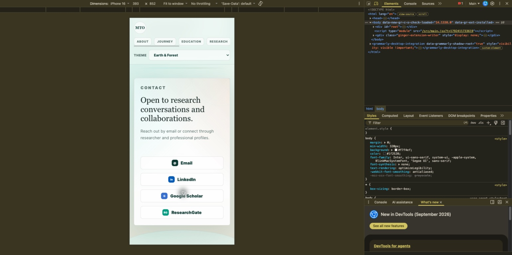

10. Smaller phone — hero fits at 375 pixels, but navigation cuts off part of Research and hides subsequent links. No additional hero layout break was observed.

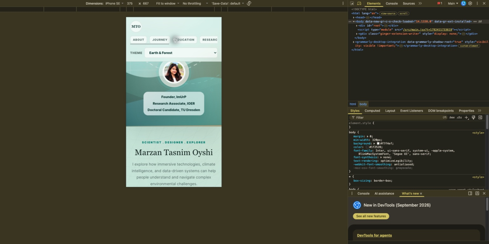

## Limits

Screenshots show the emulated viewport inside Chrome. No Safari, Android hardware, screen-reader, comprehensive keyboard, measured contrast, network-throttling, or full external-link testing was performed. No claim of full WCAG compliance or complete absence of horizontal overflow is made. The browser's developer tools error indicator was visible, but its cause was not investigated in this visual review.
